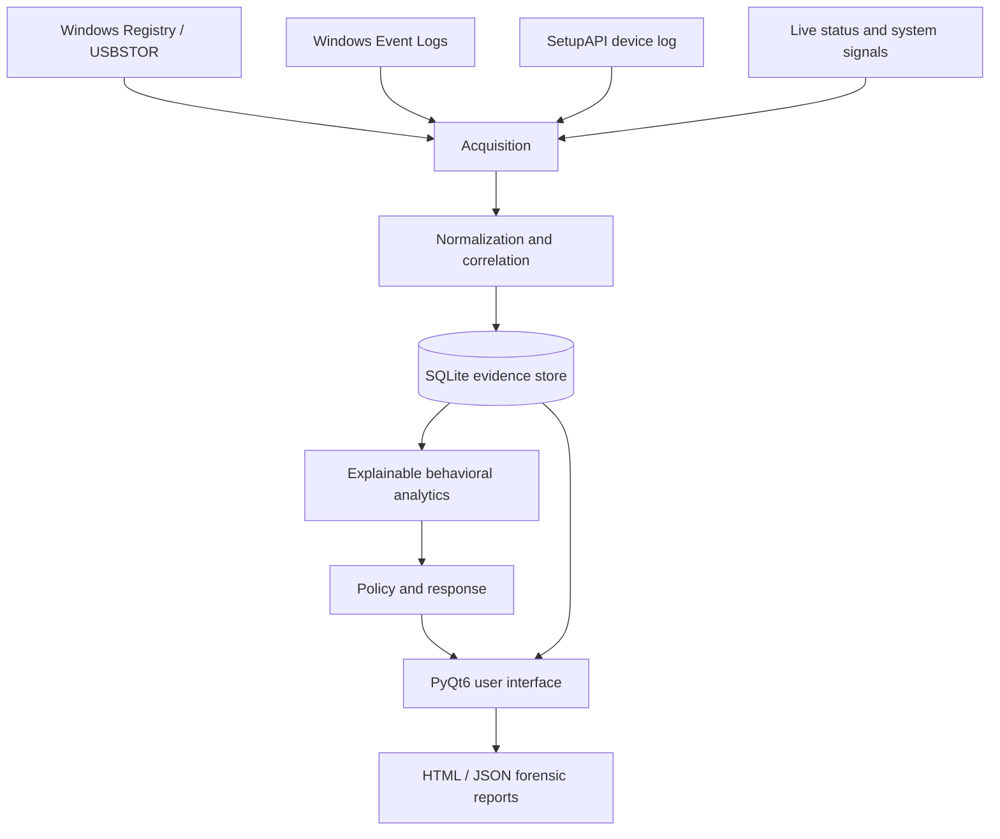

# Windows USB Forensics & Anomaly Detection

**Master's thesis — Cybersecurity | University of Alicante | 2026**  
**Author:** Diego Lanuza Izquierdo

> **Publication status: private preparation repository.** This repository currently contains documentation of the completed academic project, not the application source code. Original source files, screenshots, test fixtures, and the full thesis must be reviewed before inclusion. No software functionality is implied by the placeholder folders.

## Overview

A Windows 11 desktop proof of concept combining **USB device forensic reconstruction**, **explainable behavioral anomaly detection**, and configurable **defensive response**. The completed thesis describes an application that correlates Windows Registry artifacts, Event Logs and SetupAPI, reconstructs device activity, stores normalized evidence in SQLite, generates alerts and forensic reports, and presents the results in a PyQt6 interface.

The aim is to connect retrospective forensic analysis with the proactive detection of unusual removable-device activity. It is a **research prototype**, not a production-ready enterprise endpoint security product.

## Core capabilities described in the thesis

| Area | What the thesis documents |
| --- | --- |
| Windows artifact acquisition | Registry USB/USBSTOR, Event Logs (EVTX), SetupAPI installation log, live device status |
| Normalization and correlation | Device identifiers, timestamps, deduplication, mult-source USB sessions |
| Evidence persistence | SQLite with per-event SHA-256 integrity hashes |
| Behavioral analysis | Baseline of familiar devices, time of connection and frequency; explainable anomaly scores |
| Policy and prevention | Learning, monitoring and strict modes; conditional blocking and TOTP-based re-enablement |
| Analyst workflow | PyQt6 desktop interface, alert explanations, HTML and JSON report exports |
| Verification | 74 pytest tests described in the thesis; controlled synthetic experiments |

**Important:** hashes alone do not prove a tamper-evident chain of custody. Physical device blocking requires elevated permissions and should only be tested on explicitly authorized devices.

## Architecture



The diagram is a conceptual overview based on the academic report, **not** a deployment diagram exposing real systems. See [Architecture](docs/architecture.md).

## Technology stack

Python 3, PyQt6, SQLite, Windows Registry/`winreg`, EVTX, SetupAPI, PowerShell/WMI, NumPy/SciPy/pandas, Jinja2, pyotp and pytest, as documented in the thesis. Exact package versions must be verified from the original `requirements.txt` before publication.

## Reported experimental results — synthetic data only

The thesis reports **74 automated pytest tests**, two controlled synthetic detection experiments, and an AUC of **approximately 0.87** in the more challenging, overlapping-class experiment (50 sessions). A decision threshold around 0.50 reported precision 0.68, recall 0.95 and F1 0.79 for that dataset. These are **historical thesis results**, not freshly reproduced benchmarks or real-world detection guarantees.

The thesis separately describes a benchmark of 1,095 synthetic sessions with processing around 2 seconds. The original code and environment must be provided before anyone can reproduce that measurement. See [Validation and limitations](docs/validation.md).

## Screenshots and source availability

- **Application source:** not yet uploaded to this preparation repository; `src/README.md` explains the review process.
- **Test suite:** not yet uploaded; the 74-test count is sourced from the thesis, not this repository.
- **Screenshots:** not yet included. The original report includes views of the interface, alerts, statistics and TOTP settings. Each candidate image must undergo a privacy and metadata review before publication.
- **Full thesis:** not published here. The description and numerical results are documented summaries.

## Repository contents

```text
README.md
SECURITY.md
.gitignore
docs/
  architecture.md
  validation.md
  publication-review.md
  next-steps.md
src/
  README.md
screenshots/
  README.md
```

## What remains before going public

1. Review the **actual original source tree** and its history, if any.
2. Check all source, sample data, screenshots, image metadata, PDF reports, device serial numbers and TOTP QR codes for private information.
3. Reproduce installation and pytest results in a controlled Windows 11 test environment (document versions and permissions).
4. Add only reviewed source and approved screenshots; verify file-based restrictions and rollback for blocking tests.
5. Run a complete pre-publication scan and manually inspect the commit history before changing visibility to public.

See [Publication safety checklist](docs/publication-review.md) and [Next steps](docs/next-steps.md).

## Context and acknowledgements

This project is based on a Master's thesis titled *Sistema inteligente de análisis forense y prevención de uso anómalo de dispositivos USB en Windows* (University of Alicante, June 2026). The repository content summarizes the project; it does not redistribute the thesis manuscript or third-party materials.

**Portfolio:** [diegolanuza.es](https://diegolanuza.es) · **Blue Team lab:** [soc-homelab-showcase](https://github.com/dlanuzaizcs-code/soc-homelab-showcase)

**License:** Not yet selected. Do not assume an open-source license applies until source and dependency rights have been reviewed.
