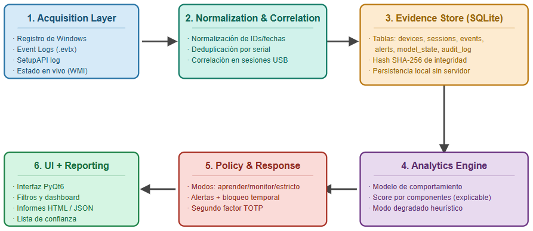
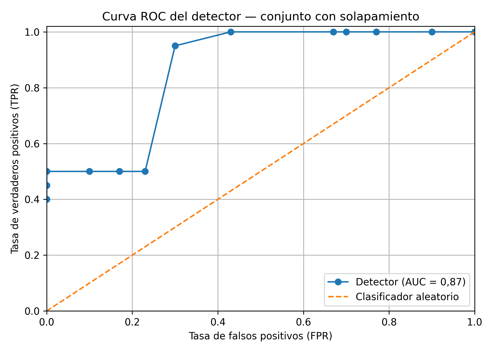
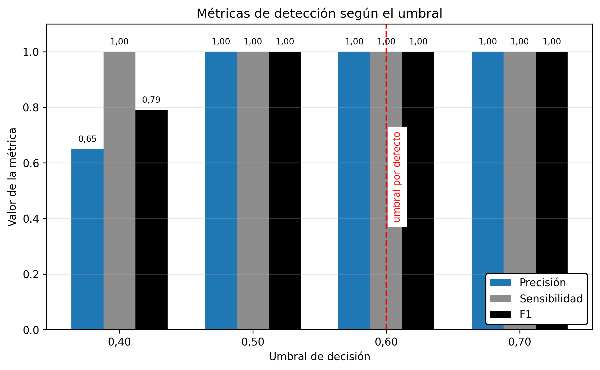

# Windows USB Forensics & Explainable Anomaly Detection

**Cybersecurity Master's Thesis · University of Alicante · 2026**  
**Author:** Diego Lanuza Izquierdo · **Platform:** Windows 11

A completed Python/PyQt6 desktop research prototype that reconstructs USB device activity, correlates forensic artifacts, models normal behavior and flags explainable anomalies. It also explores configurable defensive responses for suspicious removable-device activity.

**[Portfolio](https://diegolanuza.es)** · **[Cyber Defense Lab](https://github.com/dlanuzaizcs-code/soc-homelab-showcase)**

## What the project demonstrates

- **USB forensics:** acquisition from Windows Registry / USBSTOR, EVTX event logs and SetupAPI.
- **Evidence correlation:** device identifiers, timestamps, sessions and source attribution, normalized and persisted in SQLite.
- **Explainable detection:** anomaly components for unfamiliar devices, unusual connection times and multivariate behavioral deviation (Mahalanobis distance).
- **Defensive controls:** learning, monitoring and strict modes; alerts, a trusted-device list and TOTP-mediated recovery from strict-policy blocking.
- **Investigation workflow:** PyQt6 GUI with device inventory, alerts, statistics and HTML/JSON exports.
- **Testing:** a reproducible pytest suite using isolated state and mocked hardware-dependent operations.

## Architecture



Acquisition → Normalization & Correlation → SQLite Evidence Store → Analytics → Policy & Response → UI & Reporting

[Architecture and policy details](docs/architecture.md) · [Source overview](src/README.md)

## Validation

**98 / 98 automated tests passed on Windows** in a test run performed by the author on **30 October 2026** (`pytest -q`, **9.22 seconds**). The submitted June 2026 thesis documented 74 tests; the repository includes the later 98-test snapshot.

The thesis reports **ROC AUC ≈ 0.87** on a **synthetic, overlapping-class dataset of 50 USB sessions**. Results from controlled synthetic data must **not** be interpreted as deployment performance or proof of malicious activity.





[Read the validation methodology and limitations](docs/validation.md).

## Technology

Python 3 · PyQt6 · SQLite · Windows Registry / EVTX / SetupAPI · NumPy / SciPy / pandas · Jinja2 · pyotp (TOTP) · pytest.

## Reproduce the automated tests

On a **Windows 11 test environment**, with Python 3.13 available:

```powershell
cd src
py -3.13 -m venv .venv
.\.venv\Scripts\python.exe -m pip install -r requirements.txt
.\.venv\Scripts\python.exe -m pytest -q
```

The application entry point is `src/main.py`. For a read-only first inspection, use a standard-user account and review the [security guidance](SECURITY.md) before running the GUI. **Strict mode can attempt physical device blocking with elevated privileges; never enable it on critical USB hardware.**

## Scope and limitations

This is a **finished academic prototype**, not a production endpoint protection platform.

- USB artifacts are indirect evidence; they do not prove that files were copied.
- Event-log access and physical blocking may require administrator privileges.
- Background monitoring runs only while the application is running, not as an independent Windows service.
- Per-event SHA-256 supports integrity checking, but does not establish a tamper-proof forensic chain of custody.
- Detection metrics are based on controlled synthetic experiments; real-world false-positive rates remain unmeasured.
- Runtime SQLite databases, real system logs, device-identifying screenshots and TOTP enrollment data are intentionally not distributed.

**Distribution:** source is presented for technical review. No software license has been granted; redistribution or reuse permissions have not been specified. Academic or third-party rights must be respected.
