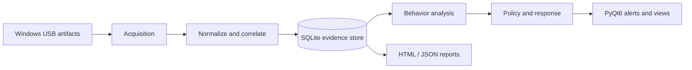

# Architecture and verified behavior

The completed Windows 11 prototype uses the six-layer conceptual design documented in the thesis. The corresponding modules are present under `src/`.

| Layer | Implementation | Responsibility |
| --- | --- | --- |
| Acquisition | `src/acquisition/` | Windows Registry, EVTX, SetupAPI and connected device / activity signals |
| Normalization & Correlation | `src/normalization/` | Identifier and timestamp normalization; event/session correlation |
| Evidence Store | `src/store/` | SQLite persistence, device/session/event records and hash-based integrity checks |
| Analytics | `src/analytics/` | Behavior baseline, explainable anomaly scores and statistical evaluation |
| Policy & Response | `src/analytics/prevention.py`, `src/monitoring/`, `src/security/` | Response policy, continuous monitoring, schedule and TOTP |
| UI & Reporting | `src/ui/`, `src/reporting/` | PyQt6 views, statistics and HTML/JSON reports |

## Operating modes

- **Learning:** gathers information to build the baseline; no alert policy blocking.
- **Monitoring:** analyzes deviations and emits detector alerts; the separate strict-mode Zero Trust rule is not enforced.
- **Strict:** evaluates trust and connection timing and can record blocking actions or attempt physical USB disabling with elevated permissions.

### Strict-mode rule in the delivered source

The function `_evaluate()` in `src/monitoring/monitor_cycle.py` considers a newly connected device compliant only when **both** conditions hold: the device is in the trusted list, **and** the connection is not anomalous for the configured schedule (including its tolerance margin).

| Trusted USB device | Within tolerated schedule | Strict-policy result |
| --- | --- | --- |
| Yes | Yes | Allowed by this rule |
| No | Yes | Alert / block |
| Yes | No | Alert / block |
| No | No | Alert / block |

This resolves a difference between two prose descriptions in the original thesis: the current strict-policy implementation **does not** exempt trusted devices outside the tolerated schedule. Devices already unlocked during the running application session can be exempted from repeated blocking.

In strict mode, `block_for_schedule()` can attempt a physical Plug and Play disable action; otherwise it records a logical block. **Do not interpret a blocked record as proof that Windows disabled the hardware.**

## Research limitations

- A USB event is an artifact, not conclusive evidence of data exfiltration.
- Missing permissions, source variability or event retention can make forensic timelines incomplete.
- Monitoring needs the application process to stay running.
- Database event hashes are not chained, independently signed evidence.
- The project has not undergone a production-readiness or enterprise privacy assessment.
