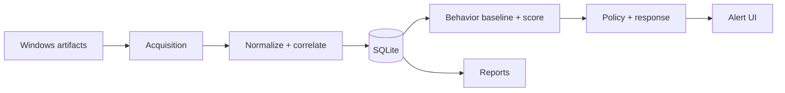

# Architecture and data flow

The academic report (section 8) describes six layers. This is a documented conceptual architecture; the actual code files must still be inspected to verify current implementation and dependencies.

1. **Acquisition**: Registry, EVTX, SetupAPI and live Windows signals.
2. **Normalization & correlation**: timestamps, device IDs, deduplication and reconstruction of USB sessions.
3. **Evidence store**: SQLite tables for devices, sessions, events, alerts, model state, system signals and configuration.
4. **Analytics**: reference behavior and transparent anomaly scoring using device familiarity, connection times and related patterns.
5. **Policy & response**: selected learning/monitoring/strict modes, alerts and conditional enforcement.
6. **User interface & reporting**: PyQt6 UI; exports to HTML/JSON.

## Modules in the thesis (section 9.1)

| Original module | Responsibility reported in thesis |
| --- | --- |
| `acquisition/` | Registry/EVTX/SetupAPI and system signals |
| `normalization/` | Normalization and correlation |
| `store/` | Persistence |
| `analytics/` | Anomaly model, orchestration, statistics and validation |
| `monitoring/` | Background polling |
| `security/` | Schedule logic, TOTP and privileges |
| `ui/` | PyQt6 interface |
| `reporting/` | HTML / JSON reports |
| `tests/` | pytest checks |
| `main.py` | Application entry point |

These module names describe the **original implementation**, not the contents currently uploaded to this scaffold.

## Important boundaries

- Windows 11 is the documented target; alternative OS support is not claimed.
- EVTX access and effective PnP-device blocking may require elevation.
- Monitor operation depends on the application running; it is not an installed independent Windows service.
- Observing USB artifacts does not prove a file-copy event or malicious activity.
- The thesis has an apparent policy description inconsistency: section 9.8 states that trusted devices outside habitual hours can require blocking/TOTP, while section 9.9 describes trusted devices as exempt from scheduled blocking. Resolve from the real code and tests before documenting an exact rule table in the public repo.
